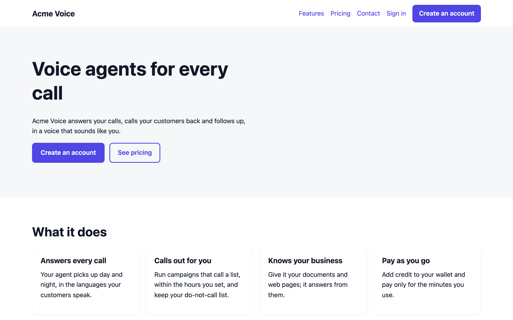
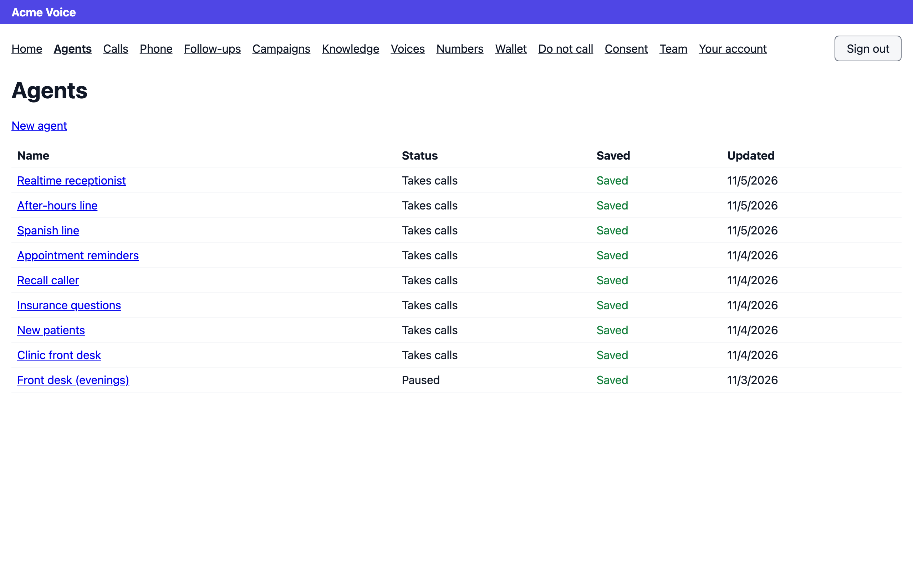
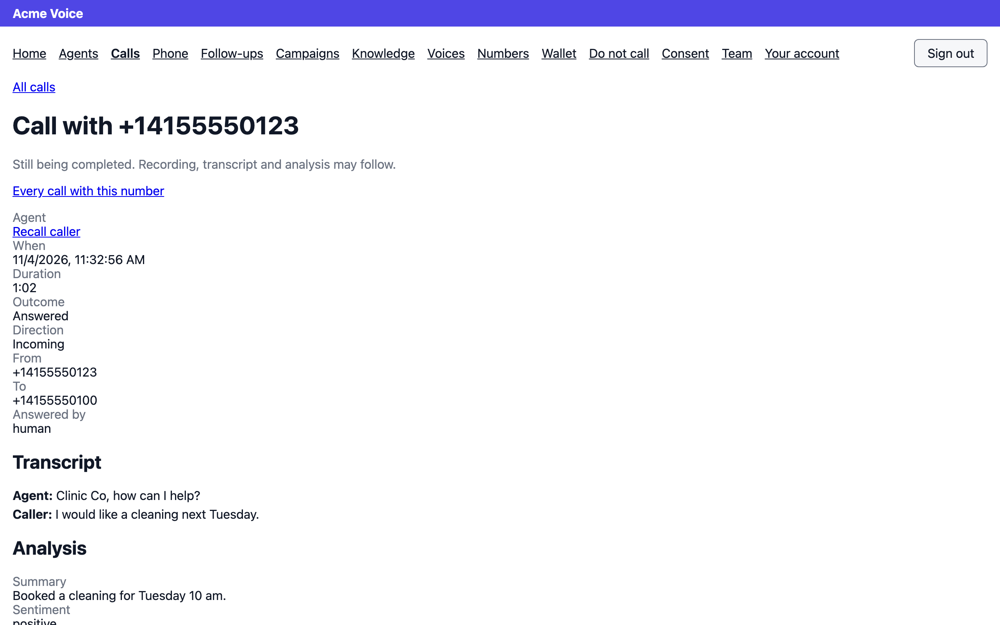
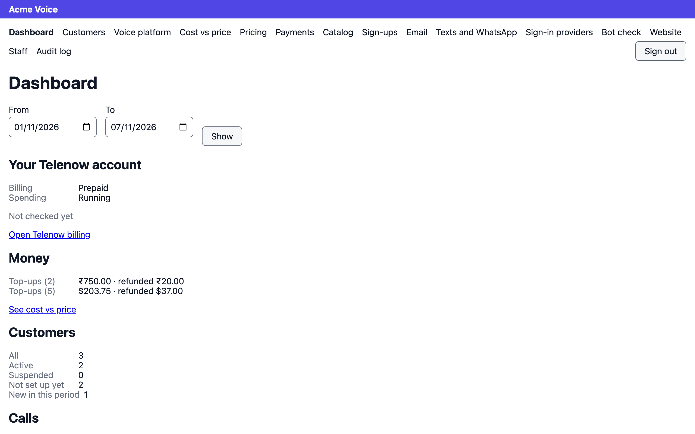
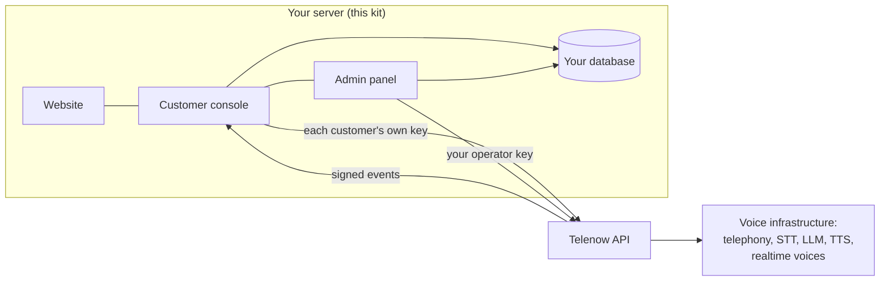

# White-Label Voice AI Kit — launch your own AI voice agent platform

[](https://github.com/TelenowAI/White-Label-Voice-AI-KIT/actions/workflows/ci.yml)
[](https://github.com/TelenowAI/White-Label-Voice-AI-KIT/releases/latest)
[](LICENSE)


**A self-hosted, white-label voice AI platform you run under your own brand.** Install it on your own server, connect your
[Telenow](https://telenow.ai) API key in the setup wizard, and you have a complete AI voice agent SaaS: a public website, a
customer console where your customers build AI phone agents, run outbound calling campaigns and buy phone numbers, an admin
panel, billing with your own prices, payment gateways and sign-ups. Telenow runs the voice infrastructure behind it — calls,
speech-to-text, text-to-speech, language models and telephony — and every one of your customers is a Telenow sub-account.

It is built for **agencies, resellers, SaaS founders, BPOs and telecom operators** who want to sell AI calling, AI
receptionists and voice automation under their own name, without building a voice AI stack from scratch.

- [Screenshots](#screenshots)
- [Features](#features)
- [How it works](#how-it-works)
- [Install](#install)
- [Development](#development)
- [Repository layout](#repository-layout)
- [Contributing and security](#contributing-and-security)
- [FAQ](#faq)
- [Changelog](CHANGELOG.md) · [Build notes](docs/BUILD_NOTES.md)

## Screenshots

| Your website, under your brand | Your customers' console: their AI agents |
|---|---|
|  |  |
| **Every call: transcript and analysis** | **Your admin dashboard** |
|  |  |

Shown with demo data: a brand called Acme Voice and a customer called Clinic Co.

## Features

### AI voice agents for your customers
- **No-code agent builder**: instructions, greetings for inbound and outbound calls, recording, call limits, silence
  handling, hanging up, voicemail, post-call analysis and QA criteria.
- **Choose the AI stack**: the language model, speech recognition (STT) and voice (TTS) providers you offer — with each
  provider's own settings (model, speed, language, temperature) and its voices filtered by model.
- **Realtime voices**: speech-to-speech models (OpenAI Realtime, Gemini Live) that listen, think and speak in one model,
  falling back to the voice pipeline when needed.
- **Voice cloning with consent**: customers clone a real person's voice once their signed release is confirmed, then give
  it to their agents. Off until you allow it.
- **Tools, look-ups and hand-overs**: agents call your customers' APIs, look callers up before the call, and hand over to
  another agent or transfer to a person.
- **Call flows**: a visual step builder for conversation, data capture, keypad input, routing, tools and transfers, with
  drafts and publishing.
- **Versions**: every change saved as a version that can be compared and put back.
- **Knowledge bases**: documents and text an agent answers from.
- **Test it in the browser**: hear a voice, hear the agent, place a browser test call, and check the voice setup.

### Calls, campaigns and phone numbers
- **Inbound and outbound AI calling** on numbers your customers buy in their console, with your number fees.
- **Outbound calling campaigns**: contacts from a CSV, a daily calling window in their time zone, attempts per person,
  settings changed mid-run, calling again, results as a CSV, and how it went.
- **Call history** with recordings and transcripts, **listen in** to live calls, and **human agents** taking calls in the
  browser with wrap-up notes and follow-ups.
- **An agent calling one person** on demand, from its page.
- **Compliance**: a do-not-call list and a consent ledger (record, import, withdraw), with an operator-wide consent rule.
- **Webhooks and after-call email** for each agent.

### Billing and payments under your prices
- **Your own price lists**: a markup or a per-minute price per call component, per plan — your margin on every call.
- **Customer wallets** with top-ups, credits, low-balance emails and limits (calls at once, monthly cap).
- **Payment gateways built in**: Stripe, PayPal, Razorpay, Paystack, Flutterwave and Tap.
- **Admin dashboard**: what customers were charged beside what the voice platform charged you, and your margin.

### Your brand, your website, your sign-ups
- **White-label everything**: your name, logo, colours and domain on the website, the console and every email.
- **Public website** with home, features, pricing, contact and legal pages, editable in the admin, with themes.
- **Sign-in options**: password, email link, email code, a code by text or WhatsApp, Google, Microsoft, or any OpenID
  Connect provider; bot check with Cloudflare Turnstile, hCaptcha or Google reCAPTCHA.
- **Email and SMS senders** you line up with fallbacks: SMTP built in, and any SMS provider with an HTTP API.

### Running the platform
- **Multi-tenant**: each customer is a workspace and a Telenow sub-account with its own encrypted key.
- **Catalog curation**: you choose which AI providers, models and voices your customers may use, under your own names.
- **Staff roles and audit log**: owner, admin and support roles; every change recorded.
- **Platform health**: scheduled jobs, the API key and incoming events, at a glance.
- **Look as the customer**: open a customer's console read-only to help them.

## How it works



- **Laravel backend** (`laravel/`): the setup wizard, the kit API, scheduled jobs, the website and every Telenow call.
  Every write to Telenow goes through an outbox: saved with the change, sent at once, and retried with the same
  idempotency key, so nothing is lost or sent twice.
- **React console** (`console/`): the customer console and the admin panel, one app shipped pre-built in every release.
- **Contract first** (`contract/`): the kit's own API is an OpenAPI document (223 operations), and every answer is
  checked against it. Telenow's answers are recorded from a real Telenow release and replayed in tests.
- **Your customers never see Telenow**: its ids, names and prices stay on your side; customers see your brand and your
  prices.

## Install

You need **PHP 8.4.1+**, a database (**MySQL 8, MariaDB 10.11, PostgreSQL 16 or SQLite**), HTTPS, a cron job, and a
**Telenow API key**. It runs on ordinary shared hosting (Apache or LiteSpeed) as well as a VPS.

1. Download the release zip from [Releases](https://github.com/TelenowAI/White-Label-Voice-AI-KIT/releases/latest)
   (or build it yourself with `pnpm release`), check it against its `.sha256`, upload and unzip it on your server, and
   point your domain at it.
2. Open the site: the **setup wizard** takes you through the database, your account, your Telenow key, your brand,
   email, sign-ups and payments.
3. Add one cron line, every minute: `php artisan schedule:run`.

Step by step, including shared hosting and updating: [laravel/INSTALL.md](laravel/INSTALL.md).

## Development

Node 22 with pnpm, and PHP 8.4.1+ with Composer. [CONTRIBUTING.md](CONTRIBUTING.md) has the full setup and every
check CI runs.

```bash
pnpm install
pnpm -r test
```

```bash
cd laravel && composer install && php artisan test
```

The console's dev server proxies `/api` to `KIT_API_URL` (default `http://127.0.0.1:8000`, a local `php artisan serve`):

```bash
pnpm --filter console dev
```

Build the release zip, and run the check every release must pass:

```bash
pnpm release
```

```bash
pnpm test:release
```

**Testing against recorded Telenow answers.** The recorded Telenow serves the cassettes in
`contract/telenow-mock/cassettes`; point a test kit at it with `KIT_TELENOW_URL` in that kit's own `.env` (without it,
the kit's default is the real Telenow):

```bash
PORT=8813 pnpm --filter contract mock
```

The contract tests also check a running backend when `KIT_BASE_URL` is set, and with a staff and a customer member's
login (`KIT_STAFF_EMAIL`, `KIT_STAFF_PASSWORD`, `KIT_MEMBER_EMAIL`, `KIT_MEMBER_PASSWORD`) read every signed-in answer
and hold it to the document. They only read, so they are safe on any backend:

```bash
KIT_BASE_URL=http://127.0.0.1:8000 pnpm --filter contract test
```

To see the emails a test kit sends, run the tests' SMTP catcher and add it in Admin → Email as an SMTP sender on
`127.0.0.1:2525` with no encryption. It is never a real mail server: it keeps each message as a line in the messages file.

```bash
php laravel/tests/Support/smtp_sink.php /tmp/kit-smtp-port /tmp/kit-smtp-messages 2525
```

The test suite runs on all four databases: MySQL 8.0, MariaDB 10.11, PostgreSQL 16 and SQLite. CI runs it on each of them
for every pull request, builds the release zip, and publishes it as a GitHub release when a version is tagged.

## Repository layout

| Folder | What |
|---|---|
| `laravel/` | The Laravel backend: setup wizard, kit API, scheduled jobs, website. Runs on ordinary PHP hosting. |
| `console/` | The customer console and the admin panel: one React + TypeScript app (Vite), two route trees. |
| `contract/` | The kit API document (`kit-api.yaml`), the resource manifest, the pricing engine spec, Telenow's released API document, the recorded Telenow answers and the contract tests. |
| `scripts/` | The release zip (`release.mjs`) and what makes a release good (`check-release.mjs`). |
| `docs/` | [Build notes](docs/BUILD_NOTES.md): how each feature was built and proven, and what was left out and why. |

## Contributing and security

Bug reports, fixes and features are welcome: [CONTRIBUTING.md](CONTRIBUTING.md) has the setup, the checks and the rules a
change keeps, and everyone follows the [code of conduct](CODE_OF_CONDUCT.md). Report a security problem privately, never
in a public issue: see [SECURITY.md](SECURITY.md). What changed in each release is in [CHANGELOG.md](CHANGELOG.md).

## FAQ

**What is a white-label voice AI platform?**
Software you sell under your own brand that lets businesses build AI voice agents — AI phone agents that answer and make
calls. This kit is the whole platform: website, customer console, admin panel, billing and payments, with Telenow's voice
infrastructure behind it.

**Do I need to build or host the voice AI myself?**
No. Telenow runs the calls, speech recognition, language models, voices and telephony. You host this kit (PHP and a
database), connect your Telenow key, and set your own prices.

**Which AI models and voices can my customers use?**
The ones you offer from Telenow's catalog: language models, speech recognition and text-to-speech providers, each with
its models, settings and voices, and realtime speech-to-speech models such as OpenAI Realtime and Gemini Live when the
platform runs them. You choose what is offered and what it is called.

**Can I set my own prices and margins?**
Yes. Price lists set a markup or a per-minute price for each part of a call, per plan. The admin dashboard shows what
customers were charged beside what Telenow charged you.

**Which payment gateways are supported?**
Stripe, PayPal, Razorpay, Paystack, Flutterwave and Tap, set up in the admin.

**Does it handle outbound calling campaigns and compliance?**
Yes: campaigns from a CSV with a daily calling window and attempts per person, a do-not-call list, and a consent ledger
with an operator-wide consent rule.

**Will my customers see Telenow?**
No. Customers see your brand, your names for the providers and voices, and your prices. Telenow's ids, names and prices
are never shown to them.

**Can it run on shared hosting?**
Yes. It runs on ordinary PHP shared hosting with Apache or LiteSpeed (see [INSTALL](laravel/INSTALL.md)), or on a VPS.

**Is it open source?**
Yes, under the MIT licence.

## Licence

MIT — see [LICENSE](LICENSE). Copyright © 2026 Telenow AI.
